  

  
  
  

## Sobre mí

Desarrollador de software full stack en **Arequipa, Perú**. Estoy terminando **Diseño y Desarrollo de Software en TECSUP** (2024 – 2026) y trabajo en todo el ciclo de una aplicación: prototipo en Figma, API, base de datos, app móvil y despliegue con integración continua. Vengo de una formación técnica en electrónica, así que también conecto software con hardware (ESP32, sensores, dispositivos hápticos).

- **BlindForge** — Desarrollador full stack de un videojuego para personas con discapacidad visual: Unity, Django, Spring Boot, React y un guante háptico con ESP32.
- **Fibertel Networks** — Prácticas en el área de software (2026).
- **Feka Studios** — Cofundador de un estudio independiente de desarrollo.

## Tecnologías

  

  

  

**Arquitectura:** Clean Architecture · CQRS con MediatR · Unit of Work · REST · Scrum y Kanban

## Proyectos destacados

| Proyecto | Descripción | Stack |
|---|---|---|
| [**Ceniza Neón**](https://github.com/CarlosFloresDev/ceniza-neon) | Juego de construcción de colonias y defensa, con jefes, en pixel art. Windows, Android y navegador. | Godot 4 · GDScript |
| [**TrackTrash**](https://github.com/CarlosFloresDev/tracktrash-mobile) | Plataforma de reciclaje y recojo de residuos para Arequipa. | Flutter · ASP.NET Core · PostgreSQL |
| [**Casa H&L**](https://github.com/CarlosFloresDev/casa-hl) | Web y sistema de gestión de un hospedaje: reservas, calendario, cotizador y caja. | Astro · React · Cloudflare D1 |
| [**Mods de Minecraft**](https://github.com/CarlosFloresDev/arequipa-bar-casino) | Seis mods en Fabric: casino arequipeño, campus Tecsup, gremios, misiones, mazmorras y TeleRadio. | Java · Fabric · Mixins |
| [**LauncherChef**](https://github.com/CarlosFloresDev/launcherchef) | Launcher de Minecraft con gestión automática de mods y sincronización remota. | Electron · React · Vite |
| [**Fachievements**](https://github.com/CarlosFloresDev/fachievements-render) | Guías para conseguir todos los trofeos y logros de tus juegos. | Astro · React · Supabase |
| [**EBONHOLD**](https://github.com/CarlosFloresDev/EBONHOLD) | Servidor de WoW WotLK con AzerothCore, web pública y launcher propio. | Next.js · Electron · Docker |

## Actividad

  
  

